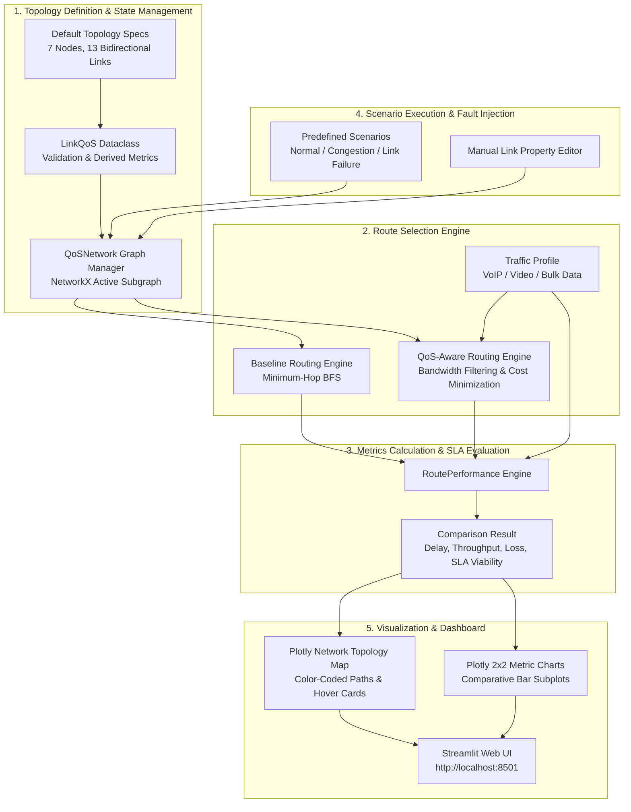

# Technical Design Document: QoS-Aware Intelligent Traffic Routing System

## 1. System Overview and Educational Scope

The **QoS-Aware Intelligent Traffic Routing and Network Resource Management System** is a modular, Python-based simulation platform designed to demonstrate modern Quality of Service (QoS) principles in computer networks. 

Traditional interior gateway routing protocols (such as standard RIP or unweighted shortest-path models) select routes purely on hop count (the fewest intermediate links). While simple and computationally lightweight, shortest-hop routing is fundamentally oblivious to link quality, propagation delays, link saturation, and packet loss. Under real-world network loads, routing traffic over the fewest hops frequently leads to severe bottlenecking, buffer bloat, and Service Level Agreement (SLA) violations for latency-sensitive applications like Voice over IP (VoIP) and interactive media.

This system demonstrates how **multi-metric QoS-aware routing** evaluates end-to-end path performance, enforces application-specific bandwidth feasibility constraints, and selects optimal paths balancing propagation delay and congestion penalties.

> [!IMPORTANT]
> **Educational Simulation Scope Notice**:
> This platform is an educational and analytical model designed to illustrate algorithmic trade-offs between hop-count routing and multi-constraint QoS path selection. It is **not** a low-level packet-by-packet network simulator (such as ns-3, OMNeT++, or Mininet) and is **not** an implementation of a production routing protocol (such as OSPF-TE, IS-IS, or BGP). All performance metrics represent analytical estimates derived from graph topology attributes.

---

## 2. End-to-End System Architecture and Lifecycle Flow

The application executes in a clean, decoupled five-stage lifecycle:



### Lifecycle Progression

1. **Topology Instantiation (`src/network/`)**: 
   The network topology is constructed with 7 nodes and 13 bidirectional links using NetworkX. Each link is assigned a `LinkQoS` object encapsulating capacity (Mbps), latency (ms), congestion (%), loss (%), and operational status (enabled/disabled).
2. **Scenario and Modification Dispatch (`src/simulation/scenarios.py`)**:
   Scenarios apply targeted link mutations (e.g., setting link congestion to 85% or disabling a link). The underlying `QoSNetwork` ensures scenario isolation via deep copying.
3. **Dual Routing Computation (`src/routing/`)**:
   - **Baseline Shortest-Hop**: NetworkX computes the unweighted minimum-hop path across enabled links.
   - **QoS-Aware**: Candidate simple paths are enumerated and filtered by profile bandwidth constraints. The path with the minimum cumulative QoS cost is chosen.
4. **Performance Metric Aggregation (`src/simulation/metrics.py`)**:
   End-to-end latency, bottleneck capacity, capacity-bounded throughput, independent packet loss, and average congestion are calculated and evaluated against traffic profile SLAs.
5. **Dashboard Rendering (`src/visualization/` & `app.py`)**:
   Plotly renders fixed 2D graph visualizers with colored overlays (Blue = Baseline, Green = QoS, Purple = Shared, Red Dashed = Disabled) and 2x2 comparative bar charts, presented in an interactive Streamlit UI.

---

## 3. Module Breakdown, Classes, and Responsibilities

The codebase follows strict separation of concerns across five core packages:

```
src/
├── network/          # Graph construction, link validation, and state mutation
├── routing/          # Routing algorithms, route data structures, and cost functions
├── simulation/       # Traffic profiles, QoS metric calculations, and scenario runners
└── visualization/   # Plotly topology visualizer and comparative chart generators
```

### 3.1 Network Package (`src/network/`)

#### `LinkQoS` (`src/network/link.py`)
- **Responsibility**: Value object storing and validating link-level QoS attributes.
- **Attributes**:
  - `bandwidth: float`: Link capacity in Mbps ($> 0.0$).
  - `delay: float`: One-way propagation delay in milliseconds ($\ge 0.0$).
  - `congestion: float`: Current link load percentage ($0.0 \le \text{congestion} \le 100.0$).
  - `packet_loss: float`: Link drop rate percentage ($0.0 \le \text{packet\_loss} \le 100.0$).
  - `enabled: bool`: Administrative operational status (`True` = operational, `False` = disabled/severed).
- **Derived Properties**:
  - `available_bandwidth`: $\text{bandwidth} \times \left(1.0 - \frac{\text{congestion}}{100.0}\right)$ if enabled, else $0.0$.
  - `effective_delay`: `delay` if enabled, else $\infty$ (`float('inf')`).
  - `loss_probability`: $\frac{\text{packet\_loss}}{100.0} \in [0.0, 1.0]$.
- **Methods**: `validate()`, `to_dict()`, `copy()`.

#### `QoSNetwork` (`src/network/topology.py`)
- **Responsibility**: Manages the mutable NetworkX graph representation of the network topology, link updates, active graph extraction, and resets.
- **Key Methods**:
  - `get_active_graph() -> nx.Graph`: Returns a subgraph containing all nodes and only enabled edges (`enabled == True`).
  - `update_link(u, v, **kwargs)`: Safely updates specific link properties with validation, maintaining undirected symmetry.
  - `disable_link(u, v)` / `enable_link(u, v)`: Toggles operational state without removing graph edge structures.
  - `reset_to_default()`: Restores the pristine default 7-node, 13-link state.
  - `find_all_paths(source, destination) -> List[List[str]]`: Discovers all simple active paths.
  - `summary() -> Dict[str, Any]`: Generates administrative summary (total links, disabled count, avg congestion, avg delay).

---

### 3.2 Routing Package (`src/routing/`)

#### `RouteResult` (`src/routing/models.py`)
- **Responsibility**: Encapsulates the output of a route selection algorithm.
- **Key Attributes**:
  - `algorithm: str`: Name of algorithm ("Baseline Shortest Path" or "QoS-Aware Routing").
  - `source: str`, `destination: str`: Path endpoints.
  - `route: List[str]`: Sequence of visited nodes (e.g., `["Node_1", "Node_3", "Node_6", "Node_7"]`).
  - `hop_count: int`: Number of traversed links ($\text{len}(\text{route}) - 1$).
  - `cost: Optional[float]`: Cumulative QoS cost of the path.
  - `found: bool`: Flag indicating whether a viable path was found.
  - `link_details: List[Dict[str, Any]]`: Per-hop snapshot of traversed link metrics.
  - `explanation: str`: Human-readable explanation of why the route was selected or why it failed.

#### Routing Utilities (`src/routing/utils.py`)
- `resolve_active_graph(network)`: Normalizes `QoSNetwork` or raw `nx.Graph` into an active graph.
- `compute_link_cost(link_data, congestion_weight=50.0) -> float`: Evaluates the mathematical cost of a single edge.
- `compile_route_metrics(active_graph, route, congestion_weight=50.0)`: Traverses path edges, computing total delay, bottleneck bandwidth, and total QoS cost.

#### Baseline Routing Engine (`src/routing/baseline.py`)
- **Function**: `find_baseline_route(network, source, destination) -> RouteResult`
- **Logic**:
  1. Resolves the active subgraph (ignoring disabled links).
  2. Identifies all active simple paths with the minimal hop count.
  3. Resolves equal-hop ties deterministically using lexicographical node sequence.
  4. Computes informational metrics without letting them bias selection.

#### QoS-Aware Routing Engine (`src/routing/qos_aware.py`)
- **Function**: `find_qos_route(network, source, destination, min_bandwidth=0.0, congestion_weight=50.0) -> RouteResult`
- **Logic**:
  1. Resolves the active subgraph.
  2. Enumerates all simple loop-free paths between source and destination using NetworkX `all_simple_paths`.
  3. **Bandwidth Feasibility Filter**: Eliminates candidate paths where any link has $\text{bandwidth} < \text{min\_bandwidth}$.
  4. **Cost Evaluation**: For each feasible path, calculates total cost:
     $$\text{Cost}(\text{path}) = \sum_{e \in \text{path}} \text{link\_cost}(e)$$
  5. **Deterministic Selection**: Chooses the path minimizing total cost. Ties are resolved by lowest hop count, then lexicographically.

---

### 3.3 Simulation Package (`src/simulation/`)

#### Traffic Profiles (`src/simulation/traffic_profiles.py`)
Configures traffic demand parameters for differentiated service classes:
- **`TrafficProfile` Dataclass**:
  - `min_bandwidth: float`: Minimum link capacity required for admission (Mbps).
  - `offered_traffic_rate: float`: Application traffic demand (Mbps).
  - `max_acceptable_delay: Optional[float]`: Latency SLA threshold (ms).
- **Predefined Profiles**:
  - `Voice (VoIP)`: Min BW = $1.0\text{ Mbps}$, Offered = $0.5\text{ Mbps}$, Max Delay = $30.0\text{ ms}$.
  - `Video Streaming`: Min BW = $25.0\text{ Mbps}$, Offered = $20.0\text{ Mbps}$, Max Delay = $75.0\text{ ms}$.
  - `Bulk Data`: Min BW = $100.0\text{ Mbps}$, Offered = $150.0\text{ Mbps}$, Max Delay = $250.0\text{ ms}$.

#### Metrics Engine (`src/simulation/metrics.py`)
Calculates end-to-end performance and verifies SLA constraints:
- `calculate_end_to_end_delay(links)`: $\sum_{i} d_i$ (ms)
- `calculate_bottleneck_bandwidth(links)`: $\min_{i} B_i$ (Mbps)
- `calculate_estimated_throughput(offered, bottleneck)`: $\min(\text{offered}, \text{bottleneck})$ (Mbps)
- `calculate_end_to_end_loss(links)`: $\left[1.0 - \prod_{i} (1.0 - p_i)\right] \times 100\%$
- `calculate_average_congestion(links)`: $\frac{1}{N} \sum_{i} C_i$ (%)
- **`RoutePerformance`**: Encapsulates all calculated metrics, SLA compliance flags (`meets_bandwidth_requirement`, `meets_delay_requirement`), and overall viability (`is_viable`).

#### Scenarios Engine (`src/simulation/scenarios.py`)
Provides reproducible network conditions and returns `ScenarioResult`:
- `load_normal_scenario(profile, source, destination)`: Pristine network baseline.
- `load_congestion_scenario(profile, congested_links, source, destination)`: Injects $85\%$ congestion onto `(Node_1, Node_3)` and `(Node_3, Node_6)`.
- `load_link_failure_scenario(profile, failed_link, source, destination)`: Disables link `(Node_3, Node_6)`.

---

### 3.4 Visualization and Dashboard (`src/visualization/` & `app.py`)

- **`create_topology_figure(network, baseline_route, qos_route, source, destination)`**:
  Constructs a Plotly scatter graph using fixed 2D node coordinates (`pos`). Visualizes inactive links in neutral gray, disabled links in red dashed lines, Baseline route in royal blue, QoS route in emerald green, and overlapping segments in purple. Hover cards display real-time link QoS parameters.
- **`create_comparison_metrics_chart(baseline_perf, qos_perf)`**:
  Renders a 2x2 Plotly bar chart grid comparing End-to-End Delay, Bottleneck Bandwidth, Estimated Throughput, and Packet Loss.
- **`app.py`**:
  Streamlit orchestration script providing sidebar scenario/profile selectors, simulation run triggers, KPI metric cards, topology viewer, comparative charts, before-and-after scenario impact tables, and an interactive manual link property editor with fault injection capabilities.

---

## 4. Mathematical Modeling and Routing Cost Formulation

### 4.1 QoS Link Cost Function

The routing cost of an individual active link $e = (u, v)$ is formulated as:

$$\text{link\_cost}(e) = \text{delay}(e) + \alpha \times \left(\frac{\text{congestion}(e)}{100}\right)$$

Where:
- $\text{delay}(e)$ is the propagation latency across link $e$ in milliseconds.
- $\text{congestion}(e)$ is the percentage link utilization ($0.0 \le \text{congestion} \le 100.0$).
- $\alpha$ is the **configurable congestion weight coefficient** (default $\alpha = 50.0$).

### 4.2 Congestion Coefficient ($\alpha$) Role and Sensitivity

The parameter $\alpha$ establishes the exchange rate between link latency and network congestion:
- When $\alpha = 0$, the algorithm minimizes pure propagation delay.
- When $\alpha = 50.0$, each $10\%$ increase in link congestion adds $5.0\text{ ms}$ of equivalent delay penalty to the path cost. Under this setting, an $80\%$ congested link incurs a $+40.0$ penalty, steering latency-sensitive traffic away from heavily congested corridors toward clean alternative routes even if they have slightly higher base propagation delays.
- A higher $\alpha$ makes the routing engine more aggressive in circumventing congestion.

### 4.3 Total Path Cost and Bandwidth Feasibility

For a candidate path $P = (v_0, v_1, \dots, v_k)$, the path is **feasible** if and only if:

$$\min_{e \in P} \text{bandwidth}(e) \ge \text{min\_bandwidth}_{\text{profile}}$$

Among all feasible candidate paths $\mathcal{P}_{\text{feasible}}$, the QoS-aware routing engine selects:

$$P^* = \arg\min_{P \in \mathcal{P}_{\text{feasible}}} \sum_{e \in P} \text{link\_cost}(e)$$

---

## 5. Explicit Limitations and Simulation Boundaries

To maintain technical integrity and avoid overstating simulation fidelity, the following boundaries are explicitly defined:

1. **Static Link Attributes vs. Dynamic Queuing**:
   Congestion is modeled as a static percentage attribute configured on each link. The simulation does not emulate physical packet queues, buffer drop policies (e.g., RED or DropTail), or stochastic packet arrivals.
2. **Idealized Throughput Bounding**:
   Estimated throughput is calculated via the capacity upper-bound:
   $$\text{Throughput} = \min(\text{Offered Traffic Rate}, \text{Bottleneck Bandwidth})$$
   It does not simulate dynamic TCP congestion window evolution, Slow Start, Additive Increase Multiplicative Decrease (AIMD), retransmission timeouts, or receiver window constraints.
3. **Statistical Independence of Packet Loss**:
   Cumulative packet loss across a multi-hop route is calculated assuming independent Bernoulli trials:
   $$\text{Loss}_{\text{e2e}} = \left[1.0 - \prod_{e \in P} \left(1.0 - \frac{\text{packet\_loss}(e)}{100}\right)\right] \times 100\%$$
   In production networks, packet loss across adjacent links often exhibits strong spatial and temporal correlation caused by bursty shared flows.
4. **Instantaneous Convergence and Zero Transient Loops**:
   Route recalculation occurs instantaneously upon link attribute updates or link failure injection. The simulation does not model routing protocol convergence latency, control plane hello/keepalive timers, or transient routing loops common in distributed distance-vector or link-state protocols.
5. **Candidate-Path Search Scalability**:
   Path discovery relies on NetworkX's `all_simple_paths` graph traversal. While computationally efficient for topologies of 7–20 nodes, candidate path enumeration scales exponentially on large, dense meshes. Production multi-constraint QoS routing in large networks typically relies on polynomial-time heuristic algorithms (e.g., SAMCRA or LARAC).
